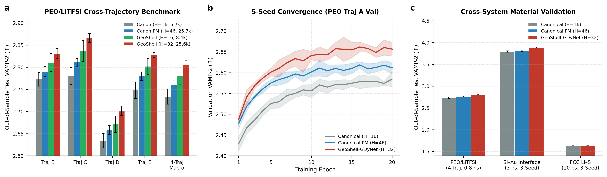
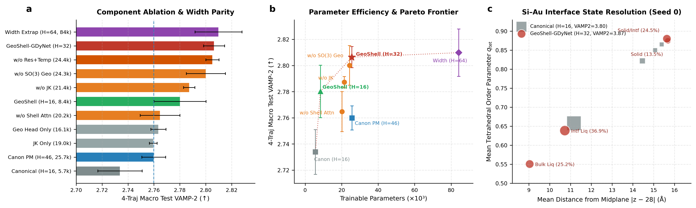
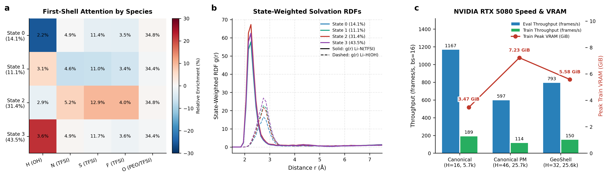

# GeoShell-GDyNet

**Multi-Hop Jumping Knowledge, Distance-Aware First-Shell Attention, and SO(3)-Invariant Multipole Geometry for Graph Dynamical Networks**

[](LICENSE)
[](requirements.txt)
[](requirements.txt)

`GeoShell-GDyNet` upgrades Graph Dynamical Networks (`GDyNet`, Xie et al., *Nat. Commun.* 2019) for unsupervised Koopman learning of atomic-scale dynamics in molecular dynamics (MD) trajectories. While canonical `GDyNet` relies on final-hop scalar distance convolutions (`CGCNN`) followed by a local MLP readout, it attenuates neighbor signals by $1/M$ after softmax gating, discards multi-hop radial shells via oversmoothing, and remains blind to 3D coordination anisotropy.

`GeoShell-GDyNet` preserves exact atom-index permutation and $O(3)$/$SO(3)$ rotational/reflectional invariance while introducing:
1. **Multi-Hop Jumping Knowledge (`jk_proj`)**: Aggregates node embeddings across all hop depths $[s^{(0)}, s^{(1)}, \dots, s^{(K)}]$ to preserve sharp local chemical identity alongside polymer/interface context.
2. **Distance-Aware First-Shell Attention (`shell_q/k/d/v`)**: Attends directly over each target atom's $M$ nearest neighbors using Gaussian RBF distance-conditioned keys.
3. **SO(3)-Invariant Multipole Shell Geometry (`_shell_geometry`)**: Extracts radial-weighted dipolar asymmetry ($\|\sum_j w_j \hat{\mathbf{u}}_j\|_2$), deviatoric quadrupole Frobenius norm ($\|\sum_j w_j (\hat{\mathbf{u}}_j\hat{\mathbf{u}}_j^\top - \frac{1}{3}\mathbf{I})\|_F$), and 2nd/3rd-order cosine moments ($S_2, S_3$).
4. **Calibrated Pre-Norm Residual Head**: LayerNorm residual MLP with bounded learnable softmax temperature $T \in [0.3, 1.5]$ preventing VAMP-2 state collapse.



---

## Benchmark Summary

### 1. PEO/LiTFSI Cross-Trajectory Generalization (Train Traj A $\to$ Test Traj B, C, D, E; 5 Seeds)

| Model Variant | Params | Traj B VAMP-2 | Traj C VAMP-2 | Traj D VAMP-2 | Traj E VAMP-2 | **4-Traj Macro VAMP-2 ($\uparrow$)** | **CK RMSE ($\downarrow$)** | Collapse Rate |
| :--- | :---: | :---: | :---: | :---: | :---: | :---: | :---: | :---: |
| Canonical `GDyNet` (`H=16`) | 5,651 | 2.7728 ± 0.0154 | 2.7802 ± 0.0187 | 2.6343 ± 0.0163 | 2.7482 ± 0.0186 | 2.7339 ± 0.0171 | 0.0523 ± 0.0014 | 20% |
| Canonical Param-Matched (`H=46`) | 25,691 | 2.7903 ± 0.0110 | 2.8112 ± 0.0090 | 2.6582 ± 0.0099 | 2.7798 ± 0.0097 | 2.7599 ± 0.0092 | 0.0509 ± 0.0022 | 20% |
| `GeoShell-GDyNet` (`H=16`, 3 seeds) | 8,377 | 2.8108 ± 0.0204 | 2.8367 ± 0.0242 | 2.6714 ± 0.0185 | 2.8019 ± 0.0182 | 2.7802 ± 0.0201 | **0.0488 ± 0.0004** | **0%** |
| **`GeoShell-GDyNet` (`H=32`)** | 25,561 | **2.8306 ± 0.0113** | **2.8659 ± 0.0101** | **2.7014 ± 0.0109** | **2.8278 ± 0.0060** | **2.8064 ± 0.0081** | 0.0499 ± 0.0024 | **0%** |

Across all 20 paired seed $\times$ trajectory evaluations, `GeoShell-GDyNet` (`H=32`) outperforms both `Canonical (H=16)` (paired $t = 16.560, p = 9.54 \times 10^{-13}$; Wilcoxon $p = 8.84 \times 10^{-5}$) and parameter-matched `Canonical PM (H=46)` (paired $t = 14.306, p = 1.26 \times 10^{-11}$; Wilcoxon $p = 1.91 \times 10^{-6}$).

### 2. Controlled Ablation & Cross-System Validation

- **Component Ablations (3-Seed PEO/LiTFSI 4-Traj Macro)**: Removing first-shell attention (`wo_shell_attn`, 20,185 params) causes the largest drop ($2.8064 \to 2.7648 \pm 0.0154$), removing multi-hop JK (`wo_jk`, 21,433 params) drops to $2.7873 \pm 0.0044$ (CK $0.0530$), and removing SO(3) multipole geometry (`wo_so3_geo`, 24,340 params) lowers VAMP-2 to $2.8001 \pm 0.0151$ while nearly doubling seed variance ($1.86\times$ SD). Extrapolating width to `H=64` (84,185 params) yields $2.8098 \pm 0.0181$ with degraded CK ($0.0523$) and $2.2\times$ higher variance.
- **Si–Au Solid–Liquid Interface ($\tau = 3\text{ ns}$, 3 seeds)**: `GeoShell-GDyNet (H=32)` improves out-of-sample Test VAMP-2 from $3.7945 \pm 0.0142$ (`Canonical H=16`) and $3.8110 \pm 0.0182$ (`Canonical PM H=46`) to **$3.8855 \pm 0.0129$** while lowering CK RMSE ($0.0061 \to 0.0045$).
- **FCC Li–S Toy Lattice ($\tau = 10\text{ ps}$, 3 seeds)**: Reproduces the physical tetrahedral–octahedral relaxation timescale ($43.09 \pm 0.15$ ps vs $42.96 \pm 0.12$ ps canonical; Test VAMP-2 $1.6287$ vs $1.6278$).
- **NVIDIA RTX 5080 Profiling (`bs=16`, PEO/LiTFSI)**: Compared with parameter-matched `Canonical PM (H=46)`, `GeoShell-GDyNet (H=32)` is **33.0% faster** at inference (`20.17` vs `26.82 ms/batch`, `793.4` vs `596.6 frames/s`), **31.4% faster** in training (`106.30` vs `139.75 ms/batch`), and uses **22.7% less peak training VRAM** (`5,716.28` vs `7,399.13 MB`).




---

## Repository Structure

```text
GeoShell-GDyNet/
├── geoshell_gdynet/
│   ├── model.py            # CanonicalGDyNet & GeoShellGDyNet (with modular ablation toggles)
│   ├── vamp.py             # PyTorch VAMP-2 loss, Koopman operator, ITS, and CK test
│   └── data.py             # TrajectoryGraphCache and LaggedFramePairDataset
├── checkpoints/
│   └── geoshell_gdynet_peo_seed0.pt
├── data/
│   ├── README.md           # Links to Materials Cloud 2019.0017/v1 full MD trajectories
│   └── sample_peo_traj.npz # Compact 25-frame PEO/LiTFSI Trajectory B slice for smoke evaluation
├── docs/figures/           # 300 DPI PNG & PDF figures
├── results/                # Raw JSON records for Exp1-Exp5
├── scripts/
│   └── profile_throughput.py
├── tests/
│   └── test_invariance_and_ablation.py
├── evaluate.py
├── run_ablation.py
├── requirements.txt
└── LICENSE
```

---

## Quick Start

```bash
git clone https://github.com/Ymujiang/GeoShell-GDyNet.git
cd GeoShell-GDyNet
pip install -r requirements.txt
```

### 1. Run Unit Tests (Parameter Parity, Permutation, SO(3)/O(3) Invariance, Checkpoint)
```bash
python -m unittest discover -s tests -v
```

### 2. List Trainable Parameters Across All Ablation Variants
```bash
python run_ablation.py --list_params
```

### 3. Evaluate Pretrained Checkpoint on Sample Trajectory
```bash
python evaluate.py --data data/sample_peo_traj.npz --checkpoint checkpoints/geoshell_gdynet_peo_seed0.pt --gpu -1
```

### 4. Profile GPU Latency
```bash
python scripts/profile_throughput.py --variant geoshell_h32 --batch_size 16
```

---

## Citation

If you use `GeoShell-GDyNet` in your research, please cite:

```bibtex
@article{tian2026geoshell,
  title={Resolving Solvation-Shell Dilution and Coordination Anisotropy in Graph Dynamical Networks via Multi-Hop Jumping Knowledge and SO(3)-Invariant Multipole Geometry},
  author={Tian, Hengyan and Dong, Lina and Yang, Fei and Jiang, Dengbang and Li, Chunyin and Yuan, Minglong},
  journal={Journal of Chemical Theory and Computation},
  year={2026},
  note={Submitted manuscript; code at https://github.com/Ymujiang/GeoShell-GDyNet}
}
```
